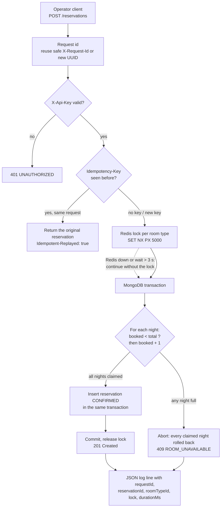

# LastRoom

[](https://github.com/Nathbobs/LastRoom/actions/workflows/ci.yml)

Backend API for a small lodging operator: per-night room inventory,
reservations that never double-book, and an idempotent webhook for booking
channels.

## The problem

A guesthouse has one room left for Christmas. A guest books it at the front
desk at the same moment a booking channel sends a reservation for the same
nights. If both requests read "1 available" before either writes, the room is
sold twice. Channels also deliver the same event more than once (timeouts,
retries), and every repeat can create another booking. LastRoom keeps
availability per night in MongoDB and claims all nights of a stay in one
transaction, so the last unit goes to exactly one request. Every channel event
is stored in an inbox with a unique key before it is processed, so a replayed
event takes effect once.

## Quickstart

Needs Docker and Node.js 24 (the demo script uses only Node built-ins, so no
`npm install`).

```sh
git clone https://github.com/Nathbobs/LastRoom.git && cd LastRoom
docker compose up -d --build --wait
npm run demo:concurrency
```

This starts the API on <http://localhost:3000>, MongoDB as a single-node
replica set and Redis. The demo creates a room type with one unit, then fires
50 parallel bookings for the same three nights. Real output from a fresh run:

```text
50 parallel POST /reservations for 1 unit(s), 3 night(s) 2026-12-24 -> 2026-12-27 (room type 6b080a67b0d047b6d7bc8e39)

┌─────────┬────────────────────────┬───────┐
│ (index) │ outcome                │ count │
├─────────┼────────────────────────┼───────┤
│ 0       │ '409 ROOM_UNAVAILABLE' │ 49    │
│ 1       │ '201 Created'          │ 1     │
└─────────┴────────────────────────┴───────┘
┌─────────┬──────────────┬───────┬────────┬───────────┐
│ (index) │ date         │ total │ booked │ available │
├─────────┼──────────────┼───────┼────────┼───────────┤
│ 0       │ '2026-12-24' │ 1     │ 1      │ 0         │
│ 1       │ '2026-12-25' │ 1     │ 1      │ 0         │
│ 2       │ '2026-12-26' │ 1     │ 1      │ 0         │
└─────────┴──────────────┴───────┴────────┴───────────┘
PASS: 1 booking(s) succeeded for 1 unit(s), booked = 1 on every night, 698 ms for 50 requests
```

`npm run demo:concurrency -- --units 5` does the same with five units (5 x 201,
45 x 409).

**Try it yourself:** interactive API docs at <http://localhost:3000/docs>.
Click _Authorize_ and use the local development key
`local-dev-api-key-change-me` (from `docker-compose.yml`; override it with
`API_KEY=... docker compose up` anywhere that isn't your laptop).

```sh
KEY=local-dev-api-key-change-me
# a room type with 2 units, inventory seeded for Dec 24-30 (seedTo is exclusive)
curl -s -X POST localhost:3000/room-types -H "X-Api-Key: $KEY" -H 'Content-Type: application/json' \
  -d '{"name":"Deluxe Double","totalUnits":2,"seedFrom":"2026-12-24","seedTo":"2026-12-31"}'
# book 2 nights (Dec 24 and 25; the check-out day is not a booked night)
curl -s -X POST localhost:3000/reservations -H "X-Api-Key: $KEY" -H 'Content-Type: application/json' \
  -d '{"roomTypeId":"<id>","checkIn":"2026-12-24","checkOut":"2026-12-26","guest":{"name":"Ada Lovelace","email":"ada@example.com"}}'
# send one signed channel event 5 times in parallel: 1 processed, 4 duplicate
npm run webhook:send -- --room-type <id> --external CHA-2001 --times 5 --parallel
```

`--external` is the channel's own booking id. Use a new one for each new
booking: the same id for a different room type or dates is rejected as
`INVALID_STATE`, on purpose (one channel booking is one reservation).

Stop with `docker compose down` (add `-v` to delete the data).

## How a booking works



MongoDB is the guarantee: the conditional `$inc` inside one transaction is what
stops a double booking, and it still holds when Redis is down
(`test/redis-down.conc-spec.ts` runs the 50-request race with Redis unreachable
and still gets exactly one success). The Redis lock only reduces write conflicts
under contention. Cancelling is the mirror image: one transaction that gives
back every night and marks the reservation CANCELLED.
