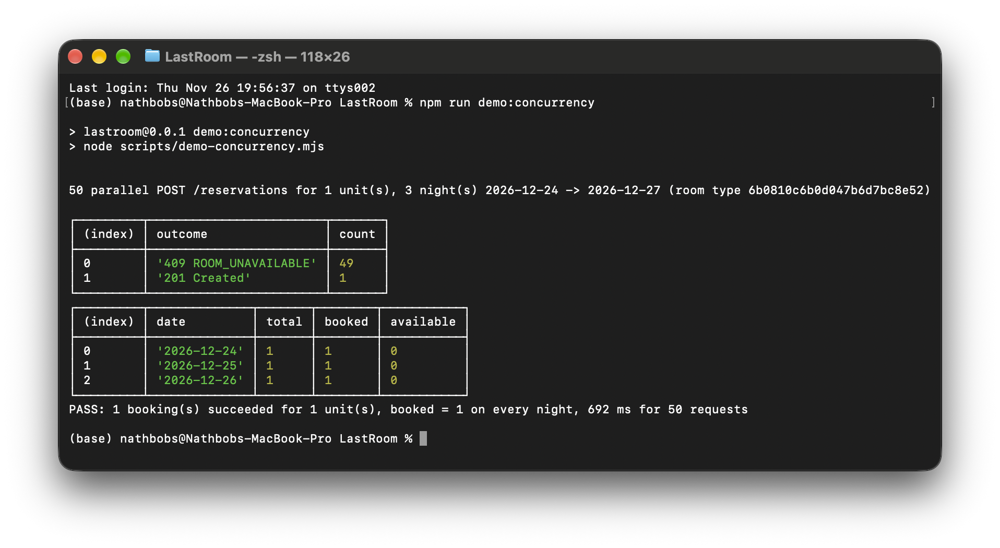
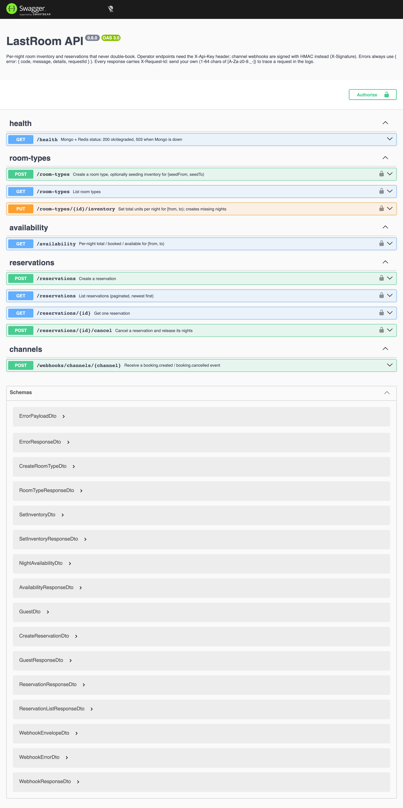
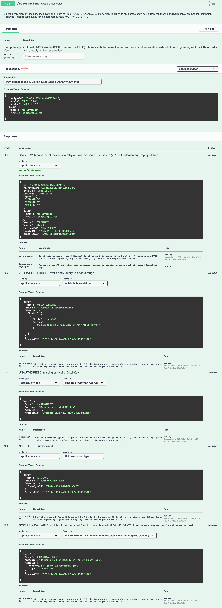
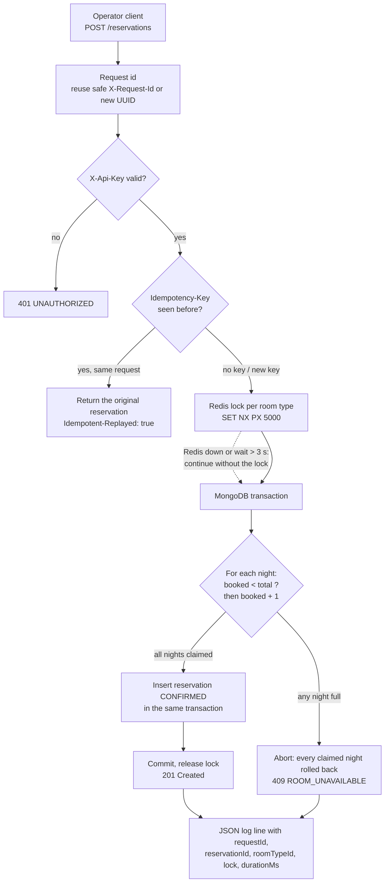
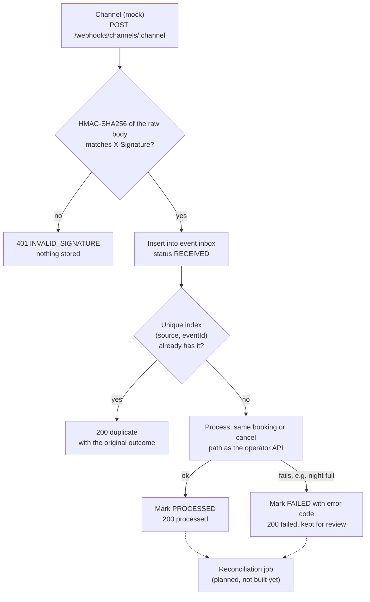
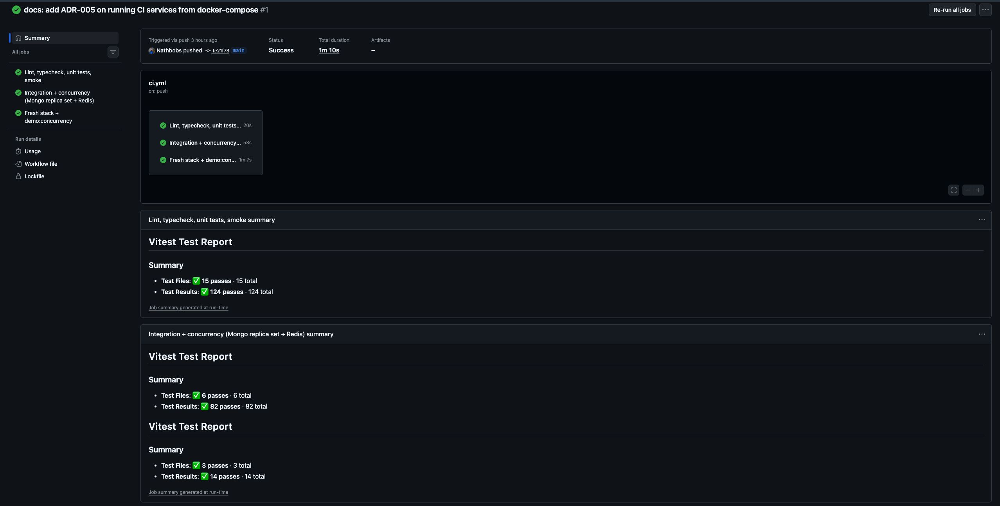

# LastRoom

[](https://github.com/Nathbobs/LastRoom/actions/workflows/ci.yml)

Backend API for a small lodging operator: per-night room inventory,
reservations that never double-book, and an idempotent webhook for booking
channels.

**Stack:**           

## The problem

A guesthouse has one room left for Christmas. A guest books it at the front
desk at the same moment as a booking channel, (i.e booking.com) sends a reservation for the same
nights. If both requests read "1 available" before either writes, the room is
sold twice. booking.com can also deliver the same event more than once (timeouts,
retries), and every repeat can create another booking. LastRoom keeps
availability per night in MongoDB and claims all nights of a stay in one
transaction, so the last unit goes to exactly one request. Every booking.com event
is stored in an inbox with a unique key before it is processed, so a replayed
event takes effect once.

## Quickstart

Needs Docker and Node.js 24 (the demo script uses only Node built-ins, so no
`npm install`).

```sh
git clone https://github.com/Nathbobs/LastRoom.git && cd LastRoom
docker compose up -d --build --wait
npm run demo:concurrency
```

This starts the API on <http://localhost:3000>, MongoDB as a single-node
replica set and Redis. The demo creates a room type with one unit, then fires
50 parallel bookings for the same three nights. Real output from a fresh run:

```text
50 parallel POST /reservations for 1 unit(s), 3 night(s) 2026-12-24 -> 2026-12-27 (room type 6b080a67b0d047b6d7bc8e39)

┌─────────┬────────────────────────┬───────┐
│ (index) │ outcome                │ count │
├─────────┼────────────────────────┼───────┤
│ 0       │ '409 ROOM_UNAVAILABLE' │ 49    │
│ 1       │ '201 Created'          │ 1     │
└─────────┴────────────────────────┴───────┘
┌─────────┬──────────────┬───────┬────────┬───────────┐
│ (index) │ date         │ total │ booked │ available │
├─────────┼──────────────┼───────┼────────┼───────────┤
│ 0       │ '2026-12-24' │ 1     │ 1      │ 0         │
│ 1       │ '2026-12-25' │ 1     │ 1      │ 0         │
│ 2       │ '2026-12-26' │ 1     │ 1      │ 0         │
└─────────┴──────────────┴───────┴────────┴───────────┘
PASS: 1 booking(s) succeeded for 1 unit(s), booked = 1 on every night, 698 ms for 50 requests
```



`npm run demo:concurrency -- --units 5` does the same with five units (5 x 201,
45 x 409).

**Try it yourself:** interactive API docs at <http://localhost:3000/docs>.
Click _Authorize_ and use the local development key
`local-dev-api-key-change-me` (from `docker-compose.yml`; override it with
`API_KEY=... docker compose up` anywhere that isn't your laptop).





```sh
KEY=local-dev-api-key-change-me
# a room type with 2 units, inventory seeded for Dec 24-30 (seedTo is exclusive)
curl -s -X POST localhost:3000/room-types -H "X-Api-Key: $KEY" -H 'Content-Type: application/json' \
  -d '{"name":"Deluxe Double","totalUnits":2,"seedFrom":"2026-12-24","seedTo":"2026-12-31"}'
# book 2 nights (Dec 24 and 25; the check-out day is not a booked night)
curl -s -X POST localhost:3000/reservations -H "X-Api-Key: $KEY" -H 'Content-Type: application/json' \
  -d '{"roomTypeId":"<id>","checkIn":"2026-12-24","checkOut":"2026-12-26","guest":{"name":"Ada Lovelace","email":"ada@example.com"}}'
# send one signed channel event 5 times in parallel: 1 processed, 4 duplicate
npm run webhook:send -- --room-type <id> --external CHA-2001 --times 5 --parallel
```

`--external` is the channel's own booking id. Use a new one for each new
booking: the same id for a different room type or dates is rejected as
`INVALID_STATE`, on purpose (one channel booking is one reservation).

Stop with `docker compose down` (add `-v` to delete the data).

## How a booking works



MongoDB is the guarantee: the conditional `$inc` inside one transaction is what
stops a double booking, and it still holds when Redis is down
(`test/redis-down.conc-spec.ts` runs the 50-request race with Redis unreachable
and still gets exactly one success). The Redis lock only reduces write conflicts
under contention. Cancelling is the mirror image: one transaction that gives
back every night and marks the reservation CANCELLED.

## How a channel webhook works



The duplicate check is the unique `(source, eventId)` index in MongoDB, not an
in-memory or Redis check, so it holds across restarts and parallel deliveries
(`test/webhooks.conc-spec.ts` sends the same event 50 times in parallel and gets
one reservation). Events that fail are answered 200 so the channel stops
retrying, and they stay in the inbox as FAILED. The dashed reconciliation step,
which would compare inventory with reservations and report failed or stuck
events, is not built yet (see [What I'd do next](#limitations-and-what-id-do-next)).

## Design decisions

- **Inventory is one document per room type per night**, `{ roomTypeId, date, total, booked }`,
  with `0 <= booked <= total` enforced by a collection validator. A stay is
  `[checkIn, checkOut)`, so a guest checking out on the 26th frees that night
  for someone checking in.
- **The MongoDB transaction is the double-booking guarantee; the Redis lock is
  optional.** A Redis lease can expire while its holder is still working, so it
  can't be what keeps bookings correct. See
  [ADR-002](docs/adr/ADR-002-double-booking.md).
- **Webhook idempotency comes from a MongoDB event inbox** with a unique
  `(source, eventId)` index, and the signature is checked over the raw request
  bytes. See [ADR-003](docs/adr/ADR-003-webhook-inbox.md).
- **Structured JSON logs traced by `requestId`**, with guest emails masked and
  no headers or bodies logged. `docker compose logs api | grep '"requestId":"<id>"'`
  shows one request from start to finish. See
  [ADR-004](docs/adr/ADR-004-structured-logging.md).
- **CI starts MongoDB and Redis from the same `docker-compose.yml`** as local
  development, because GitHub's service containers can't start MongoDB as a
  replica set. See [ADR-005](docs/adr/ADR-005-ci-uses-compose.md).

## API at a glance

All endpoints except the webhook and `/health` need the `X-Api-Key` header.
Request and response examples are in Swagger at `/docs`.

| Method | Path                                  | What it does                                     |
| ------ | ------------------------------------- | ------------------------------------------------ |
| `POST` | `/room-types`                         | Create a room type, optionally seeding inventory |
| `GET`  | `/room-types`                         | List room types                                  |
| `PUT`  | `/room-types/:id/inventory`           | Set `total` for a range of nights                |
| `GET`  | `/availability?roomTypeId=&from=&to=` | Free units per night                             |
| `POST` | `/reservations`                       | Book a stay (optional `Idempotency-Key` header)  |
| `GET`  | `/reservations`, `/reservations/:id`  | List or read reservations                        |
| `POST` | `/reservations/:id/cancel`            | Cancel and give the nights back                  |
| `POST` | `/webhooks/channels/:channel`         | Channel events, signed with HMAC                 |
| `GET`  | `/health`                             | MongoDB and Redis status                         |

Every error has the same shape, and the `requestId` matches the
`X-Request-Id` response header and the log lines:

```json
{
  "error": {
    "code": "ROOM_UNAVAILABLE",
    "message": "...",
    "details": {},
    "requestId": "..."
  }
}
```

Codes: `VALIDATION_ERROR` (400), `UNAUTHORIZED` and `INVALID_SIGNATURE` (401),
`NOT_FOUND` (404), `ROOM_UNAVAILABLE` and `INVALID_STATE` (409),
`INTERNAL_ERROR` (500).

## Tests

| Command              | What runs                                               | Count   |
| -------------------- | ------------------------------------------------------- | ------- |
| `npm test`           | unit tests, no I/O                                      | 124     |
| `npm run test:int`   | the real app over HTTP against MongoDB and Redis        | 82      |
| `npm run test:conc`  | parallel requests on a listening port, incl. Redis down | 14      |
| `npm run test:smoke` | loads the compiled app under plain Node ESM             | 1 check |

Integration and concurrency tests need `docker compose up -d mongo redis` and
`npm install`. CI runs all of them plus the demo on a fresh stack on every push.
[docs/testing.md](docs/testing.md) maps each requirement to the test that
covers it.



## Limitations and what I'd do next

- **Reconciliation job (planned, not built).** A scheduled job that checks
  `booked` against the CONFIRMED reservations for every night, and reports
  FAILED or stuck RECEIVED webhook events, including a cancel that arrived
  before its booking. It would report, not fix.
- **Queue-based webhook processing.** Today the webhook processes the event
  before answering. Acknowledging right after the inbox insert and processing
  from a queue would answer channels faster under load; the RECEIVED rows can
  already act as that queue.
- **Real channel APIs.** The channel is a mock with a simple JSON payload. Real
  OTAs each have their own formats, retry rules and availability push.
- **Multi-property.** One operator, one property. Tenancy would need a
  property id on every document and in every index.
- **Smaller image.** The runtime image is 253 MB, mostly the Node binary and
  production dependencies (TypeScript is pulled in by `@nestjs/swagger`).

Out of scope on purpose: payments, pricing, guest UI.

## How it was built

Built with Claude Code as a coding agent. I wrote the spec and made the design
decisions (per-night inventory, transactions as the guarantee, Redis as an
optional optimisation), and reviewed and tested the generated code. The code
and ADRs were drafted with Claude Code.

## References

Ideas I learned from (credited, not copied):

- AWS Builder, [Designing a Flash-Sale Seat Reservation System (Part 2): Never Sell a Seat Twice](https://builder.aws.com/content/3JnLIIiUojSd8QGb32xPTQdumEZ/designing-a-flash-sale-seat-reservation-system-in-aws-part-2-never-sell-a-seat-twice): invariants, failure modes, race tests, a reconciler.
- Adamo Software, [Building a Real-Time Hotel Booking Engine: double-booking across 6 OTAs](https://dev.to/adamo_software/building-a-real-time-hotel-booking-engine-how-we-solved-double-booking-across-6-otas-3g7o): optimistic locking, reconciling channels.
- [tweetgeek/hotel-room-booking-mvp](https://github.com/tweetgeek/hotel-room-booking-mvp): NestJS booking with ADRs and a concurrency integration test.
- [Payment Webhooks Will Lie To You](https://dev.to/mickyarun/payment-webhooks-will-lie-to-you-heres-how-we-built-ones-that-dont-in-nestjs-30g9): raw-body HMAC, ack fast, dedupe by event id.
- [Redis Locks: Working, Failure Modes and Real-World Examples](https://engineeringatscale.substack.com/p/redis-distributed-locks-explained): why the database must enforce the constraint.
